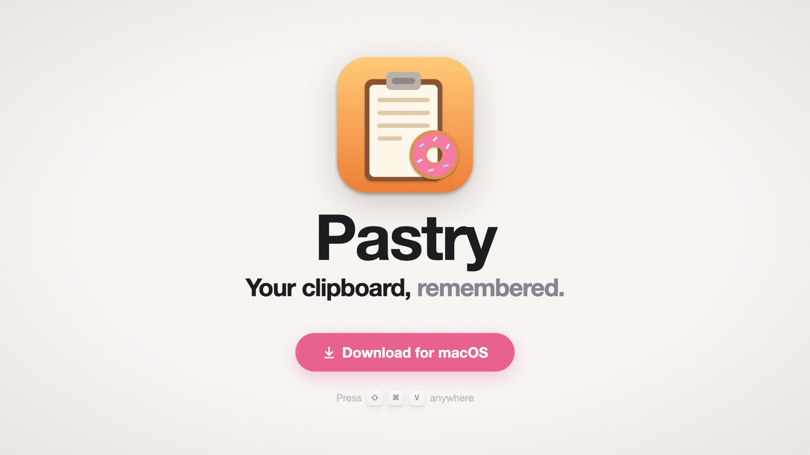
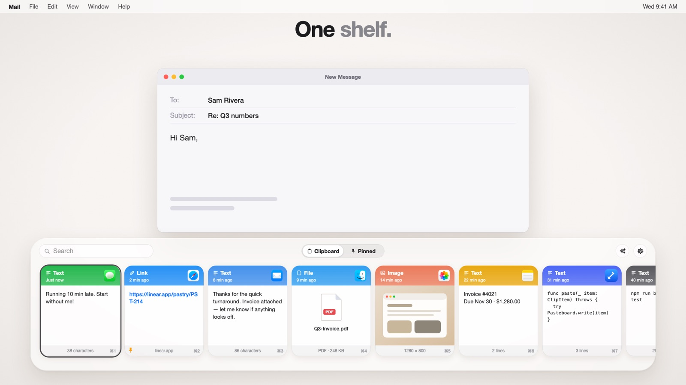
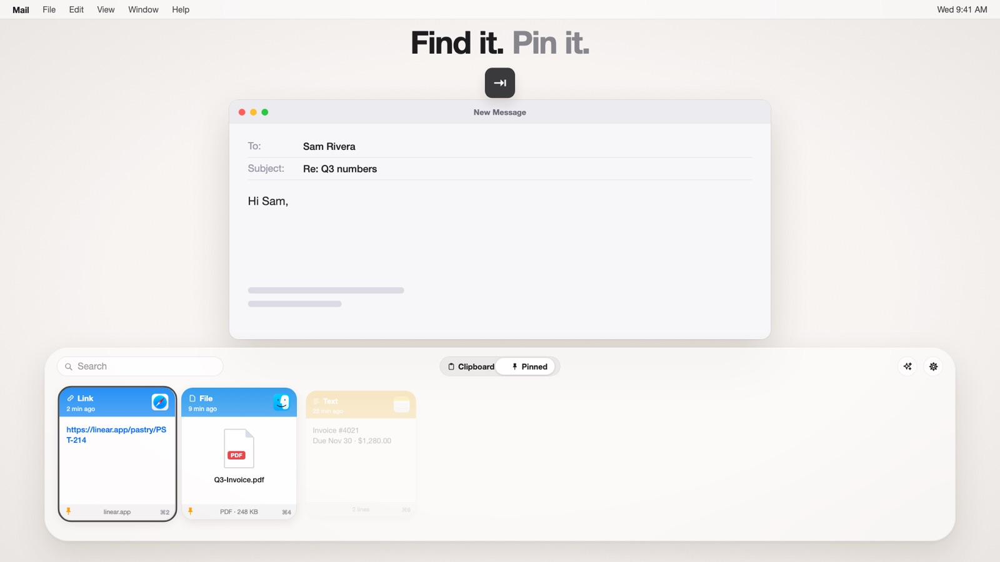
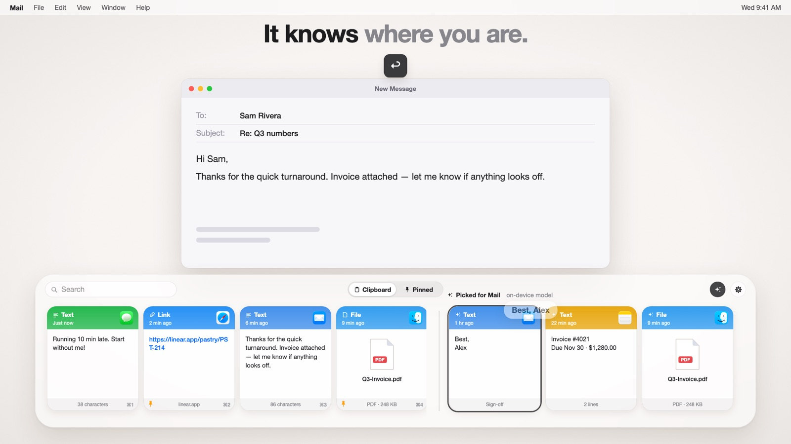
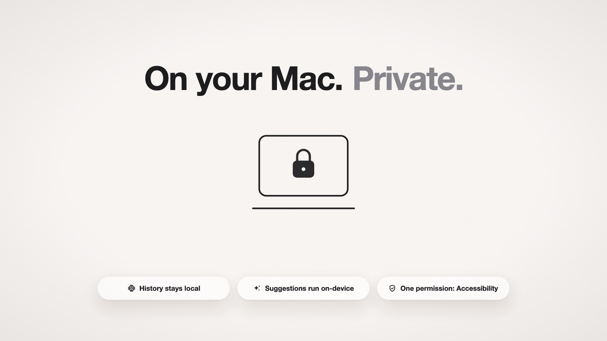
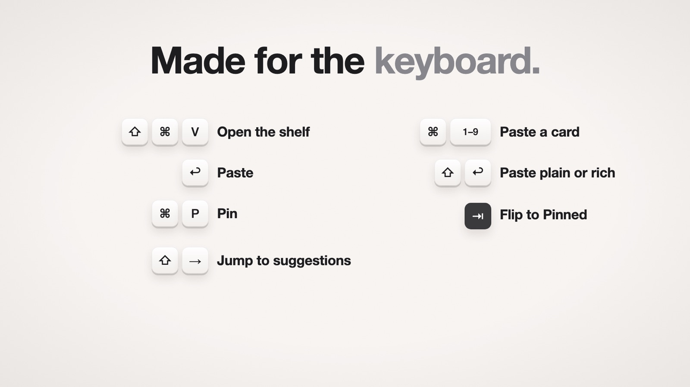

  <a href="https://github.com/mzc6101/pastry/releases/latest/download/Pastry.dmg"><b>⬇️ Download Pastry for macOS</b></a>
  &nbsp;·&nbsp; free, forever &nbsp;·&nbsp; macOS 14+ · Apple Silicon

# Pastry

**Your clipboard, remembered.** Pastry keeps everything you copy (text, links, images, files) on a glass shelf at the bottom of your screen. Press ⇧⌘V, pick a card, and it's pasted. That's it.

## Why Pastry exists

A clipboard history is a small, basic utility. It shouldn't cost a monthly fee.

Over the last few years, many popular clipboard managers have moved to subscriptions, and some people who paid for what they understood to be a one-time or "lifetime" purchase feel they ended up being pushed toward recurring payments anyway. I think charging a subscription for something this basic is wrong.

So Pastry is the opposite: **free, open source, no account, no subscription, no tracking.** Your history never leaves your Mac. If you find it useful, you can [buy me a coffee](#support), but you never have to.

## What it does

- **One shelf for everything you copy.** Text, links, images (with real thumbnails) and files each get a card, tinted by the app you copied from.
- **Paste in one keystroke.** ⇧⌘V opens the shelf over any app. ↩ pastes the selected card into the app you were in, ⇧↩ pastes as plain text, and ⌘1–9 pastes a card directly.
- **Search and pin.** Start typing to filter your history. ⌘P pins a card so it's never cleared, and Tab flips to your pinned cards.

- **Smart suggestions, on-device.** The three tiles on the right are picked for the app you're in: email text and sign-offs in Mail, code in Xcode, links and short replies in chat apps. A fast local ranker fills them instantly, and Apple's on-device model refines them when Apple Intelligence is available. ⇧→ (or ⌘→) jumps to them, and the ✦ button turns them off.

- **Right-click any card** to paste, paste as plain text, copy, **edit the text**, pin, open, reveal in Finder, Quick Look, share or delete.
- **Private by design.** History is stored locally in a small SQLite file. Concealed clipboard items (password managers) are skipped, and you can add apps to ignore. Nothing is sent anywhere.

- **Made for the keyboard.**

- **Settings you'd expect.** Change the shortcut, choose how long history is kept (a day to forever) and its maximum size, clear history, launch at login, sound on copy, plain-text paste by default, ignored apps, and replay the onboarding tour.
- **Lightweight.** About 0% CPU when idle, no menu bar icon, no Dock icon. Nothing runs while the shelf is closed.

🎬 Watch the [launch video](https://github.com/mzc6101/pastry/releases/download/v1.0.0/pastry-launch.mp4).

## Install

1. **[Download Pastry.dmg](https://github.com/mzc6101/pastry/releases/latest/download/Pastry.dmg)**, open it and drag **Pastry** to **Applications**.
2. Pastry isn't notarized by Apple yet, so macOS blocks the first launch. Right-click Pastry in Applications → **Open** → **Open**. Or run `xattr -dr com.apple.quarantine /Applications/Pastry.app`.
3. A short tour walks you through it. Grant Accessibility when asked (System Settings → Privacy & Security → Accessibility) so Pastry can paste for you. Then press ⇧⌘V anywhere.

## Support

Pastry is free and always will be. If it saves you time, you can buy me a coffee ☕ (link coming soon).

---

## For developers

### Build and install
    ./build.sh               # builds build/Pastry.app, ad-hoc signs it, quits any running Pastry, installs /Applications/Pastry.app
    ./build.sh --no-install  # build only
    open -a Pastry

The build also draws the app icon (`tools/make-icon.swift` -> iconset -> `iconutil`).

### Use
- Cmd-Shift-V (changeable) opens the shelf. Return pastes, Shift-Return pastes plain/rich (inverse of your default), Cmd-1..9 paste a card, Cmd-P pins, Tab toggles Pinned, Backspace deletes the selected card, Esc closes. Right-click a card for Paste / Paste as Plain Text / Copy / Edit Text… / Pin / Open / Reveal in Finder / Quick Look / Share… / Delete.
- Smart suggestions: the right-most three tiles ("Suggested for <App>") are picked from your history for the app you are in, by a fast rule-based ranker that the on-device Apple Intelligence model refines when available (cached per app and history, nothing leaves the Mac). Shift-Right jumps to the first tile, Shift-Left returns to history; Cmd-Right also turns suggestions on if they are off; the sparkles button next to the gear (or Settings > General) turns it off. Clicking elsewhere or switching apps closes it.
- There is no menu bar item. Settings: gear button on the shelf, Cmd-, , or open Pastry again. Quit: Cmd-Q or Settings > General > Quit.
- Pasting into other apps needs Accessibility: System Settings > Privacy & Security > Accessibility > add /Applications/Pastry.app. The shelf shows a banner with a button until granted. `build.sh` signs with a self-signed "Pastry Dev" code-signing identity (login keychain) so the grant survives rebuilds; if it is missing it falls back to ad-hoc with a fixed designated requirement. The shelf and Settings poll the trust state live and offer "Relaunch Pastry" when a grant exists but this process predates it.
- Data: `~/Library/Application Support/Pastry/history.sqlite`; preferences in UserDefaults `com.manavchordia.pastry`.

### Debug
`PASTRY_DB=<path>` scratch database, `PASTRY_AUTOSHOW=1` show the shelf at launch, `PASTRY_APPEARANCE=dark|light` force appearance, `PASTRY_NO_GLASS=1` use the pre-macOS-26 material look, `PASTRY_AX_FORCE=missing|stale|trusted` fake the Accessibility banner state, `PASTRY_AUTOSETTINGS=<tab>` open Settings at launch, `PASTRY_AUTOMENU=menu|edit|editsave` open a card menu/editor at launch, `PASTRY_NO_AX_PROMPT=1` skip the one-time Accessibility prompt, `Pastry --dump` list stored items. With `open`, pass `--env VAR=x --stdout file` to see the log.

### Signing
Create the identity once: `openssl req -x509 -newkey rsa:2048 -nodes -days 3650 -subj /CN=Pastry\ Dev -addext keyUsage=critical,digitalSignature -addext extendedKeyUsage=critical,codeSigning -keyout k.pem -out c.pem`, then `openssl pkcs12 -export -inkey k.pem -in c.pem -out p.p12 -passout pass:x` and `security import p.p12 -k ~/Library/Keychains/login.keychain-db -P x -T /usr/bin/codesign`.

### Launch video
`launch-video/` is a Remotion project (`npm install`, then `npx remotion render src/index.ts Pastry out/pastry-launch.mp4`). App icons are not checked in: export them from `/System/Applications/*.app` into `launch-video/public/apps/` (finder, mail, messages, notes, photos, preview, safari, terminal `.png`) before rendering.
